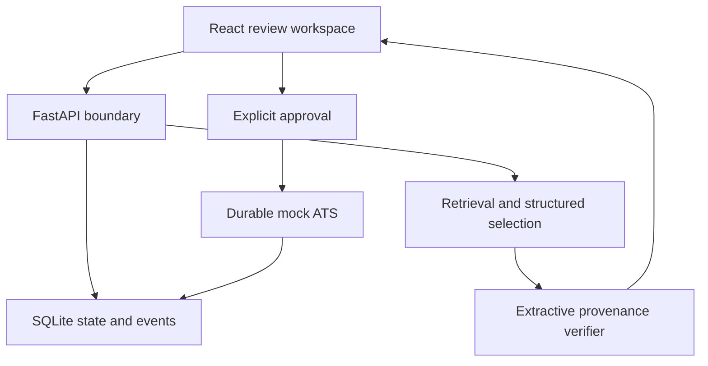

# Architecture

The optional configured model API selects evidence excerpts. Deterministic mode uses the same verification and review boundary without credentials. Neither mode submits automatically. Reviewers can inspect state transitions and a synthetic receipt; the receipt is not an employer acknowledgement.

See CONTRACTS.md for interfaces and ENGINEERING_DECISIONS.md for tradeoffs. Implementation-specific validation and limitations are recorded in the test, security, evaluation and performance reports.
